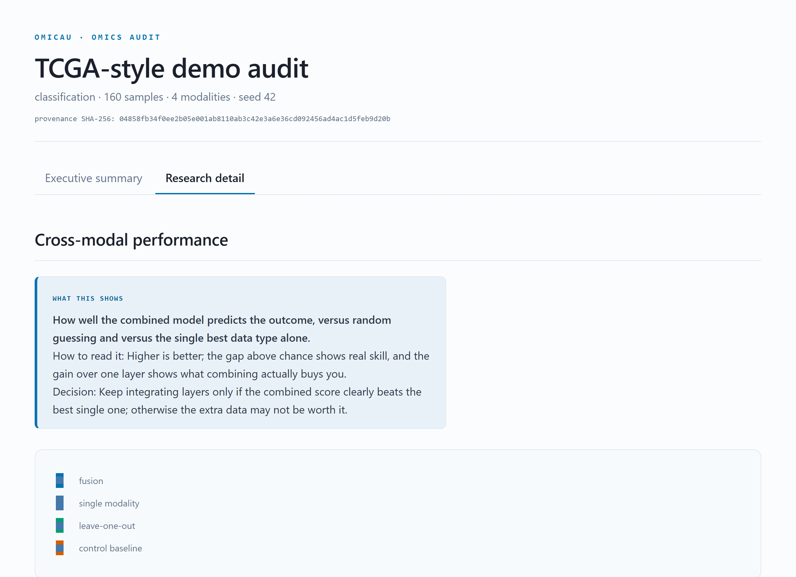

# Omicau

Local command-line tool and optional browser interface for auditing multi-omic inputs and assessing what an assay adds to a predictive model.

[Release v0.6.0](https://github.com/tunabirgun/omicau/releases/tag/v0.6.0) · [Run guide](https://tunabirgun.github.io/omicau/guide.html) · [Interpretation](https://tunabirgun.github.io/omicau/interpretation.html) · [Evaluation](https://tunabirgun.github.io/omicau/reproducibility.html)



## Install

Requires Python 3.10 or later. Download the wheel from the [v0.6.0 release](https://github.com/tunabirgun/omicau/releases/tag/v0.6.0) and install it:

```bash
python -m pip install ./omicau-0.6.0-py3-none-any.whl
```

Version 0.6.0 is not published to PyPI or Conda. The release also provides Windows x86-64, Linux x86-64 and macOS ARM64 desktop bundles; the Windows bundle is unsigned and the macOS bundle is not signed or notarized.

For the browser interface, extract the release source archive and run from its root:

```bash
python -m pip install ".[ui]"
omicau ui
```

Keep the terminal open and use the local address it prints.

## Minimal usage

The offline example uses synthetic data and is separate from the archived evaluation:

```bash
omicau check-env
omicau bootstrap --dataset mock --out-dir demo
omicau run --config demo/config.json --cores 1
omicau verify --config demo/config.json --audit demo/run/audit.json
```

The report is written to `demo/run/report.html`.

Real runs take one numeric matrix per assay and a clinical table that defines identifiers and outcome. Preserve missing values. Set `clinical.group` to the outermost independent unit, such as the patient; repeated observations must stay in the same group. Configuration and supported designs are described in the [run guide](https://tunabirgun.github.io/omicau/guide.html). Stacking and fixed-plan controls require the contracts in [fixed-split controls](docs/fixed-split-controls.md).

## Interpretation and limits

The assay ledger compares a prespecified classical reference model with refitted assay-omission models on shared assessment partitions. The unrounded family decision interval assigns each assay an increased, reduced or unresolved category; pairs that cannot be assessed keep their reasons. Standalone, neural and feature-attribution results do not determine the category.

- Intervals resample saved held-out predictions. They exclude variability from retraining, feature reselection and partition selection.
- Family quantiles carry no established population-coverage or family-error guarantee.
- With only one assay, a contribution comparison is not applicable; survival outcomes are unsupported by this paired rule.
- Results establish neither clinical utility nor causal biology.

`omicau verify` checks the aligned-input fingerprint. It does not replay model fitting or validate the full configuration, the software environment or any conclusion, so retain inputs, configuration and outputs together.

## Citation

The archived evaluation of Omicau 0.6.0 is deposited on Zenodo; cite the versioned record you use.

- [Results v3.0.0](https://doi.org/10.5281/zenodo.23444757)
- [Protocol v6.3.0](https://doi.org/10.5281/zenodo.23444777): executed-study consolidation and deviations, not a new preregistration.

Incomplete cases and comparator restrictions are part of that evidence, and secondary comparisons do not establish a general method ranking. Prediction-level reproduction requires obtaining the documented data under its access terms. The [benchmark-record guide](docs/benchmark-records.md) separates current deposits from legacy repository materials; `benchmark_record/CITATION.cff` is historical and is not citation metadata for the current evaluation.

## License

[MIT](LICENSE). Source datasets keep their own licences and access conditions.
